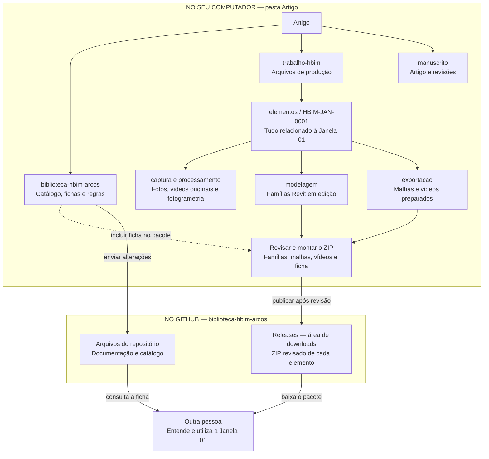

# Diagrama de demonstração

O diagrama explica a organização de arquivos e a separação entre acervo local, documentação no Git e pacotes em Releases. A Janela 01 usa o ID `HBIM-JAN-0001`. O mesmo padrão vale para outras janelas e portas. O acervo local e os pacotes futuros são preparados pela equipe; a publicação atual mantém sua estrutura original.

## Como interpretar

- **No computador:** você conserva as fontes e desenvolve o trabalho dentro de `Artigo`.
- **No repositório do GitHub:** a equipe encontra o catálogo, as fichas e as regras de organização.
- **Em Releases:** quem vai utilizar a biblioteca baixa os arquivos prontos, em um ZIP por elemento.
- **O manuscrito:** permanece separado na pasta local prevista para escrita e revisão.

As setas representam envio, publicação e uso. Esses passos são feitos pela equipe; o diagrama não configura sincronização automática. A seta pontilhada indica que uma cópia da ficha também acompanha o ZIP.

O código `HBIM-JAN-0001` identifica a mesma janela em todos os lugares. A cópia Git local tem o mesmo nome do repositório remoto, mas o acervo de trabalho e o manuscrito ficam fora dela.
